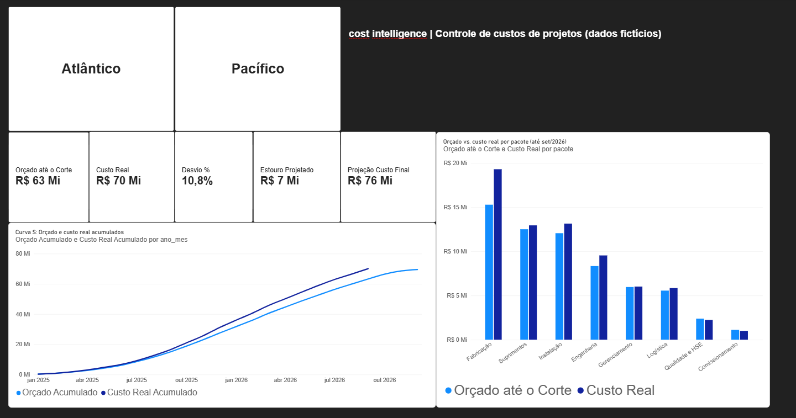

# Cost Intelligence

Sistema de inteligência de custos para projetos de engenharia: base de dados, modelo estrela e dashboard em Power BI para comparar orçado e custo real, identificar desvios e projetar o custo final, mais uma API em Python que expõe os mesmos números para automações e agentes de IA. Automação e agentes de IA estão no roadmap.

> **Todos os dados deste projeto são fictícios.** Projetos, fornecedores, notas fiscais e valores foram gerados por script.



## O problema

Em controle de custos de projetos, o orçamento vai até o fim da obra, mas o custo real só existe até a data de hoje. O desafio é responder, com os dados disponíveis:

- Quais pacotes de trabalho já estouraram o orçamento, e por quanto?
- Onde o desvio é crítico e onde está sob controle?
- Se o ritmo de desvio continuar, quanto o projeto vai custar no final?

## Resultados (dados fictícios, posição em 30/09/2026)

| Projeto | Orçado até o corte | Custo real | Desvio | Projeção do custo final | Estouro projetado |
|---|---|---|---|---|---|
| Atlântico | R$ 38,81 mi | R$ 43,49 mi | +12,1% | R$ 46,46 mi | R$ 4,46 mi |
| Pacífico | R$ 24,41 mi | R$ 26,56 mi | +8,8% | R$ 29,90 mi | R$ 2,40 mi |
| **Total** | **R$ 63,23 mi** | **R$ 70,06 mi** | **+10,8%** | **R$ 76,36 mi** | **R$ 6,86 mi** |

Destaques do projeto Atlântico: **Fabricação** com +33,6% de desvio (alta do preço do aço) e **Engenharia** com +15,6% (mudanças de escopo), ambos classificados como Crítico. O custo real do Atlântico (R$ 43,49 mi) já passou do orçamento total do projeto (R$ 42 mi).

## Dados

Gerados por `gerar_dados.py` (seed fixa, reprodutível). Detalhes e dicionário em [`dados/LEIA-ME.md`](dados/LEIA-ME.md).

- 2 projetos (Atlântico, R$ 42 mi; Pacífico, R$ 27,5 mi), 8 pacotes de trabalho e 31 fornecedores
- Orçamento mensal em curva em S
- 1.949 lançamentos de custo (notas fiscais) e 24 aditivos contratuais
- Choques de custo realistas: alta do aço, mudança de escopo, mau tempo no mar e congestionamento portuário

**Problemas de qualidade inseridos de propósito:** ~3% dos lançamentos sem categoria, 15 notas fiscais duplicadas e lançamentos com status Pendente e Glosado.

## Tratamento e modelo

- **Power Query:** importação dos CSVs (UTF-8, separador `;`, decimal `,`), tipos de dados e remoção de duplicatas (1.949 para 1.934 linhas).
- **Modelo estrela:** 4 dimensões (projetos, pacotes, fornecedores, calendário), 3 fatos (orçamento, lançamentos, aditivos) e 10 relações um-para-muitos com filtro em direção única.

## Medidas DAX (15)

| Medida | O que faz |
|---|---|
| Orçado, Orçado até o Corte, Orçamento Final do Projeto | Orçamento total, limitado ao mês de corte, e até o fim do projeto |
| Custo Real | Soma dos lançamentos, excluindo os Glosados |
| Desvio R$, Desvio % | Diferença entre custo real e orçado até o corte |
| Projeção Custo Final, Estouro Projetado | Projeção do custo ao fim do projeto e diferença para o orçamento |
| Status do Pacote | Crítico (> 15%), Atenção (> 5%) ou Dentro do orçamento |
| Orçado Acumulado, Custo Real Acumulado | Base da curva S |
| Aditivos Aprovados, Lançamentos sem Categoria, Data de Corte, Mês de Corte | Apoio e controle de qualidade |

## Decisões de negócio

- **Mês de corte:** orçado e real são comparados só até a última data com custo registrado. Sem isso, o desvio apareceria falsamente negativo.
- **Glosados ficam fora do custo real,** pois são valores não reconhecidos. **Pendentes entram,** pois ainda serão pagos.
- **Projeção por pacote:** a projeção é calculada pacote a pacote (custo real + orçamento restante × desvio acumulado do pacote) e somada. Assim, pacotes que já esgotaram o orçamento não inflam a projeção, e a medida fecha no total.
- **Limitação:** a projeção supõe que o orçamento restante estoura na mesma proporção do desvio acumulado. Não considera avanço físico, sazonalidade nem aditivos.

## Validação

Os totais do Power BI foram conferidos com um cálculo independente em Python, direto dos CSVs (por exemplo, orçado até o corte do Atlântico: R$ 38.813.510 nos dois).

## API de custos (Python)

API em FastAPI que responde sobre os custos **com as mesmas regras das medidas DAX**. Ela é a camada que a automação e o agente de IA vão usar para consultar os dados. Detalhes e lista de endpoints em [`api/README.md`](api/README.md).

```bash
pip install -r api/requirements-dev.txt
python -m pytest
python -m uvicorn api.main:app --reload
```

Depois abra <http://127.0.0.1:8000/docs> para testar os endpoints pelo navegador. Exemplo: `GET /pacotes/Fabricação?projeto=Atlântico` devolve o status Crítico, o desvio de +33,6%, o custo por categoria, os meses com maior estouro, os maiores lançamentos, os fornecedores e os aditivos do pacote.

**23 testes automatizados** conferem a API contra os números validados no Power BI (por exemplo, projeção total de R$ 76.364.663).

## Como abrir

1. Baixe `cost-intelligence.pbix` e abra no Power BI Desktop (Windows).
2. Os dados já estão carregados no arquivo. Para atualizar a partir dos CSVs, ajuste o caminho da pasta `dados` em **Transformar dados > Configurações da fonte de dados**.

## Roadmap

- [x] **Fase 1:** base de dados, modelo estrela, medidas DAX e dashboard
- [x] **API:** consulta dos custos em Python (FastAPI), com testes automatizados
- [ ] **Fase 2:** automação (n8n ou Make) com IA para classificar os lançamentos sem categoria e alertar quando um pacote estourar o orçamento
- [ ] **Fase 3:** agente de IA que consulta a base, explica os desvios e escreve o relatório mensal
- [ ] **Fase 4:** aplicação onde o gestor pergunta em linguagem natural, por exemplo "por que Fabricação estourou?"

## Ferramentas

Python (geração e validação dos dados; API com FastAPI, pandas e pytest), Power BI (Power Query, DAX e visualização) e Claude (apoio na construção e revisão do projeto).
